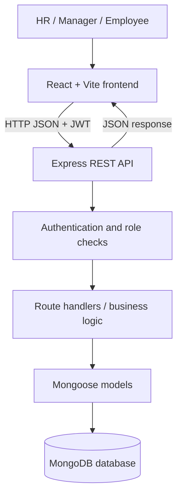

# Task 1 — Technical Architecture

## Overview
StaffSync follows a client–server architecture. The React frontend presents role-specific screens and sends HTTP requests to an Express REST API. The API validates requests, authenticates users with JWTs, checks role permissions, invokes Mongoose models, and returns JSON responses. MongoDB stores application records.

## Components
- **Presentation layer:** React pages and components in `client/src`.
- **API layer:** Express routes and handlers in `server/src/index.js`.
- **Authentication:** token verification and role middleware in `server/src/auth.js`.
- **Data layer:** Mongoose schemas/models in `server/src/models.js`.
- **Initial data:** `server/src/seed.js` provides local demonstration records.

## Request lifecycle
1. A user signs in through the frontend.
2. The API validates credentials and returns a token.
3. The frontend attaches the token to protected API requests.
4. Middleware verifies the token and checks the user's role where required.
5. A handler reads or updates MongoDB through a Mongoose model.
6. The API returns a JSON response and the UI refreshes its state.

## Limitations to note
The diagram describes the supplied starter code's intended architecture. Confirm each path and permission by running the application and reviewing the actual source before making claims in a formal evaluation.
