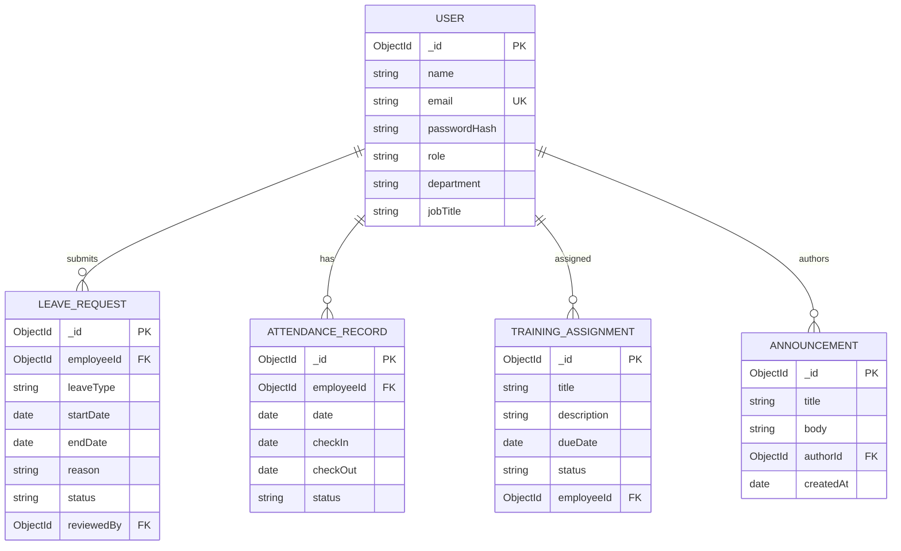

# Task 2 — ER Diagram

The following conceptual ER diagram represents the main data entities for StaffSync. Field names may be adjusted to match the actual Mongoose schemas in `server/src/models.js`; this is a logical model, not a MongoDB relational constraint diagram.

## Relationship notes
- One user can submit many leave requests.
- One user can have multiple attendance records over time.
- A manager/HR user may review leave requests; the reviewer reference is optional until reviewed.
- Announcements have an author and may be visible to multiple roles.
- Training assignments can be associated with employees.

**Before submission:** compare the diagram with the exact fields in `server/src/models.js`. If the implementation has a different schema, update this diagram to match the code rather than claiming this conceptual diagram is exact.
