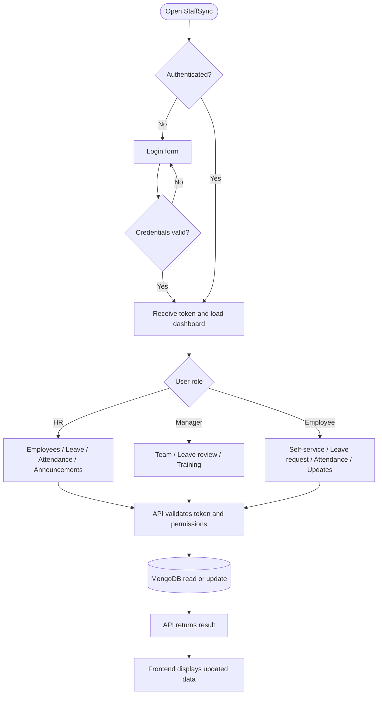

# Task 5 — User Flow

## Typical employee flow
1. Open the application and sign in.
2. View the dashboard.
3. Open leave management and submit a request.
4. Review attendance and announcements.
5. Open training information if available.

## Typical HR flow
1. Sign in with an HR account.
2. Open the employee directory.
3. Review or manage employee records.
4. Review pending leave requests.
5. Publish an announcement.

Use the running application to capture the exact flow and amend this document if the implemented screens differ.
