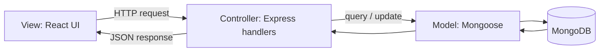

# Task 6 — MVC Pattern

MVC means **Model–View–Controller**. It separates data representation, user interface, and request handling/business logic.

- **Model:** Mongoose schemas and models in `server/src/models.js` define the stored data and database operations.
- **View:** React components in `client/src` display pages, forms, tables, and feedback.
- **Controller / request handling:** Express route handlers in `server/src/index.js` process requests, apply validation/authorization, call models, and return responses.

The supplied project uses a practical MVC-inspired organization. Since route handlers may be colocated in a single Express file rather than separate controller files, describe it as **MVC-inspired** unless you refactor the code into distinct controller modules.
